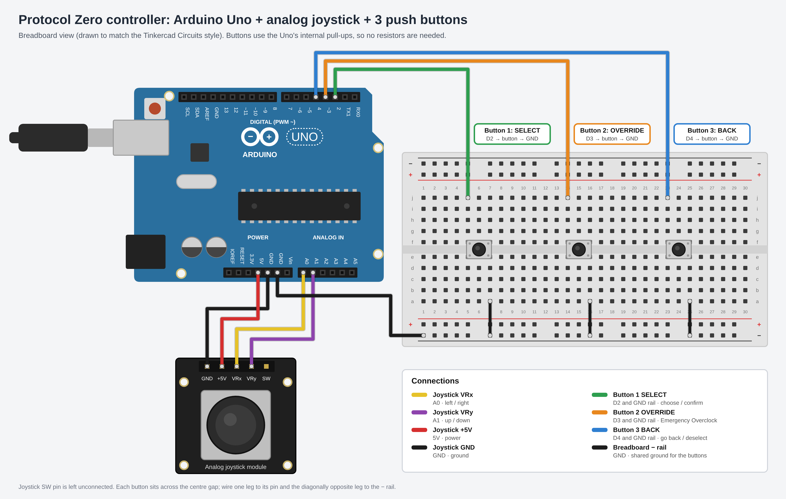

# Protocol Zero — Arduino controller (joystick + 3 buttons)

The controller is optional. With it unplugged (or with no Python), the game plays exactly as before with mouse and keyboard, and mouse and keyboard keep working while it is plugged in.



`controller_circuit.png` is a drawing of the circuit in the Tinkercad breadboard style (`make_circuit.py` writes it as an SVG), not a Tinkercad export.

## Parts and pins

| Part | Pin |
|---|---|
| Analog joystick module: VRx | A0 |
| Analog joystick module: VRy | A1 |
| Analog joystick module: +5V, GND | 5V, GND |
| Button 1 **SELECT** (to GND, internal pull-up) | D2 |
| Button 2 **OVERRIDE** (to GND, internal pull-up) | D3 |
| Button 3 **BACK** (to GND, internal pull-up) | D4 |

No resistors, no LCD, no LED, no libraries. The joystick's SW pin is not used. Each button sits across the gap in the middle of the breadboard: one leg goes to its pin, the diagonally opposite leg goes to the − rail, and the − rail goes to GND.

## What the controls do

| Control | On the board | In a menu |
|---|---|---|
| Joystick | Moves the yellow cursor one tile (hold to keep moving). While the tower picker is open it changes the tower. | Moves the highlight between buttons |
| SELECT | On an empty green socket: opens the tower picker, and SELECT again builds the tower shown. On a tower: selects it. On the Arduino core tile during the build phase: starts the next wave. | Presses the highlighted button |
| OVERRIDE | Emergency Overclock: +150 Energy, adds 50 System Load (same as the O key) | — |
| BACK | Closes the tower picker, leaves placement mode, or deselects the tower | Goes back one screen |

Upgrading, repairing and selling a selected tower, tower abilities and pause stay on the keyboard and mouse (U, R, S, F1–F5, P).

## 1. Upload the sketch (once)

1. Open `protocol_zero_controller/protocol_zero_controller.ino` in the Arduino IDE, board **Arduino Uno**, pick the port, Upload.
2. Optional test in the Serial Monitor (115200 baud): you should see `HELLO PZ2`, then `HB` every second, `JOY U` / `JOY D` / `JOY L` / `JOY R` when you push the stick, and `BTN SELECT` / `BTN OVERRIDE` / `BTN BACK` when you press a button.
3. If the cursor moves the wrong way for how your joystick is mounted, change `INVERT_X`, `INVERT_Y` or `SWAP_XY` at the top of the sketch and upload again.

Close the Serial Monitor before starting the game: only one program can use the port.

## 2. Install the bridge's one dependency (once)

```
pip3 install pyserial
```

## 3. Play

Plug the Arduino in and start the game. The game starts `tools/hardware_bridge.py` by itself; when the board is found the HUD shows **CONTROLLER LINKED**. Push the joystick and the cursor appears. If it doesn't connect, run the bridge by hand in a terminal to see what it says:

```
python3 tools/hardware_bridge.py            # or: --port /dev/cu.usbmodem1101 (macOS), COM5 (Windows)
```

## Test without a board

```
godot --headless --path . res://tools/checks/check_hardware.tscn
```

## Building the same circuit in Tinkercad

1. New Circuit. Drag in an **Arduino Uno R3**, a **Breadboard Small** and three **Pushbuttons**.
2. Tinkercad's parts list does not have a joystick module, so use two **Potentiometers** in its place: one is the X axis, the other the Y axis.
3. Place each pushbutton across the centre gap of the breadboard, a few columns apart.
4. Wire Uno **GND** to the breadboard **−** rail.
5. For each button, wire one leg to its pin (**D2**, **D3**, **D4**) and the diagonally opposite leg to the **−** rail.
6. For each potentiometer, wire terminal 1 to **GND**, terminal 2 to **5V**, and the wiper to **A0** (X) or **A1** (Y).
7. Click **Code**, choose **Text**, and paste the sketch. Start Simulation and open the Serial Monitor: turning a potentiometer to either end sends `JOY` lines, clicking a button sends its `BTN` line.
